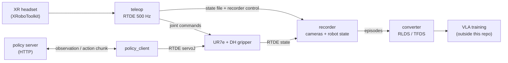

# UR_ros2


A ROS 2 Jazzy workspace for collecting demonstrations and deploying learned policies on a
Universal Robots **UR7e** arm with a DH parallel gripper. It covers the full real-robot loop:

1. **Teleoperate** the arm from an XR headset over RTDE at 500 Hz.
2. **Record** synchronized camera images, robot state, and teleop actions as episodes.
3. **Convert** the episodes to RLDS (TFDS) for vision-language-action (VLA) training.
4. **Deploy** a trained policy served over HTTP and execute its action chunks with RTDE `servoJ`.



## Components

| Component | What it does |
| --- | --- |
| [`teleop`](src/teleop/README.md) | XR teleoperation scripts (not a colcon package) that drive the arm directly through RTDE (no ROS driver in the loop) and the gripper through the UR tool-communication port. Also starts/stops recording from the controller buttons. |
| [`recorder`](src/recorder/README.md) | ROS 2 node that samples cameras, robot state, and the teleop action stream at a fixed rate and writes one directory per episode. |
| [`converter`](src/converter/README.md) | Script that turns recorded episodes into an RLDS dataset readable with `tensorflow_datasets`. |
| [`policy_client`](src/policy_client/README.md) | Robot-side deployment node: builds observations, queries a policy server over HTTP, and executes the returned joint-space action chunks with RTDE `servoJ`. Model-specific notes live in [`adapters/`](src/policy_client/adapters/README.md). |
| [`controllers`](src/controllers/README.md) | Classic ROS 2 action/topic wrappers around `ur_robot_driver` and the gripper, for debugging or for integrations that need ROS interfaces. |
| `controllers_msgs` | Message and action definitions used by `controllers` (documented in the `controllers` README). |

## Requirements

**Hardware**

- Universal Robots UR7e in *Remote Control* mode, reachable from the workstation over Ethernet.
- DH gripper on the UR tool flange, accessed through the UR tool-communication serial port
  (the ToolComm Forwarder URCap must be running on the robot; default port 54321).
- Intel RealSense cameras (a primary view and an optional wrist view).
- An XR headset supported by [XRoboToolkit](https://github.com/XR-Robotics), with the XRoboToolkit PC Service installed on the workstation.

**Software**

- Ubuntu with ROS 2 Jazzy, `ur_robot_driver`, and `ur_client_library`.
- Python packages, per component:

| Component | Python packages |
| --- | --- |
| `teleop` | `ur_rtde`, `xrobotoolkit_sdk`, `pinocchio`, `xacro`, `pyserial`, `numpy`; `ruckig` (optional target smoothing) |
| `recorder` | `ur_rtde`, `pyrealsense2`, `opencv-python`, `numpy` |
| `converter` | `tensorflow`, `tensorflow-datasets` (in a separate virtual environment, without ROS sourced) |
| `policy_client` | `ur_rtde`, `pyrealsense2`, `requests`, `pyserial`, `numpy` |
| `controllers` | `pyserial` |

`teleop` is usually run from a separate Python environment that provides `xrobotoolkit_sdk`.
`recorder` runs under the active virtual environment, or the interpreter passed as its
`python_executable` launch argument; it imports `ur_rtde` even when it does not open its own RTDE connection.

## Build

```bash
cd <UR_WORKSPACE>
source /opt/ros/jazzy/setup.bash
colcon build --symlink-install
source install/setup.bash
```

`<UR_WORKSPACE>` is the root of this repository. Placeholders such as `<ROBOT_IP>` are used throughout the docs.

## Workflows

### Collect demonstrations

Run each step in its own terminal, after sourcing ROS 2 and `install/setup.bash`.

```bash
# 1. Start the XRoboToolkit PC Service with real-time priority (once per boot).
src/teleop/start_xr_service_rt.sh

# 2. Power on the arm and release the brakes through the UR Dashboard Server.
#    The teach pendant must be in Remote Control mode.
python3 src/teleop/start_ur.py --robot-ip <ROBOT_IP>

# 3. Expose the gripper serial port as /tmp/ttyUR.
python3 /opt/ros/jazzy/lib/ur_client_library/tool_communication.py <ROBOT_IP> --device-name /tmp/ttyUR

# 4. Start teleoperation (in the Python environment that provides xrobotoolkit_sdk).
python3 src/teleop/teleop.py --robot-ip <ROBOT_IP> --ur-type ur7e \
  --control-mode speed_j_dls --enable-recorder-control

# 5. Start the recorder (in the Python environment that provides pyrealsense2 and ur_rtde).
ros2 launch recorder record.launch.py dataset_root:=<DATASET_DIR>
```

With `--enable-recorder-control`, the XR controller buttons start, stop, save, and discard episodes.
The full recommended teleop command, the button map, and keyboard or service alternatives are in the
[`teleop`](src/teleop/README.md) and [`recorder`](src/recorder/README.md) READMEs.

### Convert to RLDS

Run the converter from the source tree, in its own virtual environment with TensorFlow and
TensorFlow Datasets, in a shell where ROS is not sourced (setup in the
[`converter`](src/converter/README.md) README).

```bash
# Validate every episode and print a summary; writes nothing.
python src/converter/scripts/RLDS.py --dataset-root <DATASET_DIR> --inspect-only

# Convert.
python src/converter/scripts/RLDS.py \
  --dataset-root <DATASET_DIR> \
  --output-dir <RLDS_DIR> \
  --language-instruction "<TASK_INSTRUCTION>" \
  --overwrite
```

The dataset is written to `<RLDS_DIR>/ur_robot_rlds/1.0.0` and loads with
`tfds.builder_from_directory`.

### Deploy a policy

Start a policy server that implements the HTTP contract described in
[`policy_client`](src/policy_client/README.md), make it reachable from the robot workstation
(for example through an SSH tunnel), then:

```bash
ros2 launch policy_client policy_joint_abs_control.launch.py \
  robot_ip:=<ROBOT_IP> \
  policy_base_url:=http://127.0.0.1:<POLICY_PORT> \
  instruction:="<TASK_INSTRUCTION>" \
  dry_run:=true
```

Start with `dry_run:=true` to check observations and actions without moving the arm.

### Alternative: ROS 2 driver and controllers

When ROS interfaces (actions, MoveIt) are needed, run `ur_robot_driver` with tool communication enabled
and the wrappers from [`controllers`](src/controllers/README.md) instead of the direct RTDE path.

## One control entry at a time

Only one program may command the arm, and only one process may own `/tmp/ttyUR`, at any moment.

| Control entry | Use it for | Do not run together with |
| --- | --- | --- |
| `teleop/teleop.py` | Data collection | `policy_client`, `ur_robot_driver` |
| `policy_client` | Policy evaluation | `teleop.py`, `ur_robot_driver` |
| `controllers` + `ur_robot_driver` | Debugging and ROS integrations | `teleop.py`, `policy_client`, a separate `tool_communication.py` |

## Safety

- Keep the emergency stop within reach and clear the workspace before enabling motion.
- Unlock a protective stop (`start_ur.py --unlock-protective-stop`) only after checking the cell.
- Test new policies with `dry_run:=true` and conservative speed limits first.

## Repository layout

```text
UR_ros2/
└── src/
    ├── teleop/            # XR teleoperation over RTDE
    ├── recorder/          # Episode recorder (ROS 2)
    ├── converter/         # Episodes → RLDS
    ├── policy_client/     # Policy deployment node and model adapters
    ├── controllers/       # ROS 2 control wrappers
    └── controllers_msgs/  # Interfaces for controllers
```

## License

[Apache License 2.0](LICENSE).
